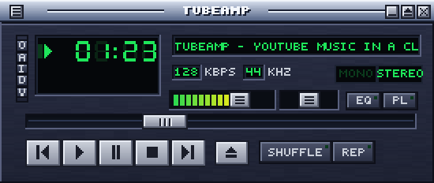
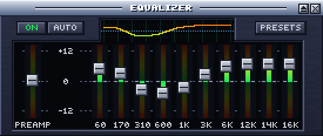
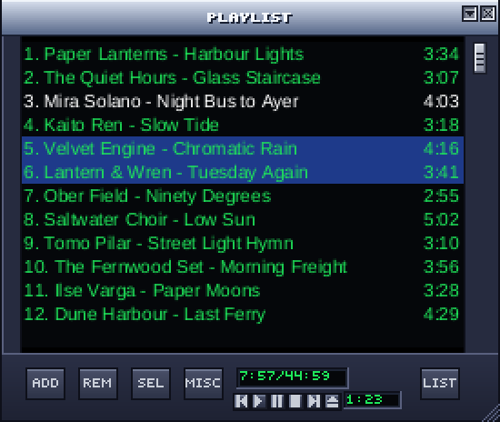
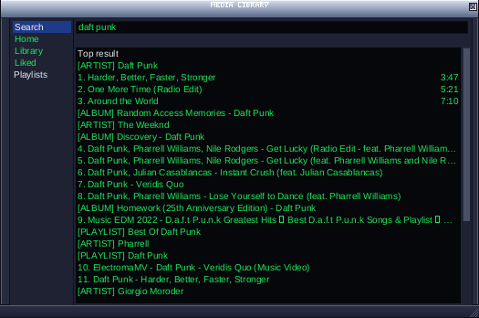
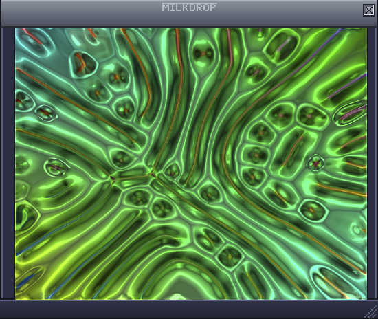

# TubeAmp

**YouTube Music, dressed up as a classic 1990s desktop player.** TubeAmp is a native Rust desktop app that plays only YouTube Music, through a pixel-exact recreation of the classic Winamp 2.x interface. It has the main window, a 10-band equalizer, a playlist editor, a video window, a Milkdrop visualizer, and it loads any classic `.wsz` skin.

<p align="center">
  <br>
  <br>
  
</p>

<p align="center">
  
  
</p>

*Screenshots use TubeAmp's own original "TubeAmp Classic" skin.*

## Features

- **Classic windows, pixel for pixel:** main window, equalizer, playlist editor, video window, Media Library and Milkdrop. Windows snap and dock together, roll up into windowshade mode, and double in size with Ctrl+D.
- **Any classic skin:** drop a `.wsz` file onto any window, or pick one from the Skins menu. Thousands are available at the [Winamp Skin Museum](https://skins.webamp.org). On first run TubeAmp can download Winamp's original 2.91 skin for you.
- **A real equalizer (macOS):** 10 bands at Winamp's frequencies, a preamp, the 17 classic presets, and `.eqf` import/export. It processes the actual audio through a Core Audio process tap.
- **Visualizers:** the classic spectrum analyser and oscilloscope, plus a Milkdrop window running [butterchurn](https://github.com/jberg/butterchurn).
- **YouTube Music inside:** search, Home, your Library, Liked songs and playlists in a skinned Media Library. The playlist editor decides what plays next. The video window shows music videos, or the album art for audio-only songs.
- **Desktop integration:** media keys, a single Now Playing entry, and a menu-bar icon. It remembers your layout, EQ, playlist and skin.
- **No API keys:** TubeAmp hosts the real music.youtube.com page in a hidden webview and drives YouTube's own player. You sign in with your own Google account (Premium works).

## Install

### macOS (14.2 or later, Apple Silicon or Intel)

Download the latest `TubeAmp-*-macos.dmg` from [Releases](https://github.com/rosdyana/TubeAmp/releases) and drag TubeAmp to Applications.

The app is **not notarized** (ad-hoc signed), so the first time you open it, use **right-click → Open**, or run:

```sh
xattr -dr com.apple.quarantine /Applications/TubeAmp.app
```

When asked, allow **System Audio Recording**. The equalizer and visualizers need it to process YouTube Music's audio, and the audio never leaves your Mac. If you decline, playback still works with the EQ off. Full guide: [docs/INSTALL-macOS.md](docs/INSTALL-macOS.md).

### Windows

Work in progress. CI builds Windows binaries, but the Windows audio path is not finished yet.

## First steps

1. Press **L** to open the video window in browser view and sign in to YouTube Music.
2. Press **Alt+L** for the Media Library, search, and press **Enter** on a track to play it.
3. Click **EQ** on the main window to open the equalizer, and **PL** for the playlist.

### Keyboard shortcuts

| Key | Action | Key | Action |
|---|---|---|---|
| Z / X / C / V / B | previous / play / pause / stop / next | ← / → | seek −5 s / +5 s |
| ↑ / ↓ | volume | Ctrl+D | double size |
| Ctrl+T | elapsed / remaining time | L or Alt+V | video window |
| Alt+L | Media Library | Ctrl+M | Milkdrop |

Double-click a title bar for windowshade. Right-click, or use the **O** button on the main window, for the menu (skins, Milkdrop, retry audio capture).

## Build from source

Requires Rust (stable) and, on macOS, the Xcode command-line tools.

```sh
cargo run -p tubeamp                      # run
cargo test --workspace --exclude m0-spike # tests
bash tools/package-macos.sh               # dist/TubeAmp.app, .dmg and .zip
```

| Path | What |
|---|---|
| `crates/app` | the application: windows, event loop, persistence, menus |
| `crates/ui` | pixel renderers for every window (main, EQ, playlist, video, gen/library) |
| `crates/skin` | `.wsz` skin loader and sprite tables |
| `crates/bridge` | the YouTube Music webview and its injected `bridge.js` |
| `crates/ytm` | parsers for YouTube Music's own (InnerTube) responses |
| `crates/audio` | macOS Core Audio process tap, spectrum analyser |
| `crates/eq` | Winamp-accurate 10-band EQ model, presets, `.eqf` |
| `crates/playlist` | playlist model (selection, sort, shuffle, repeat) |
| `tools/skingen` | generates the original default skin and the app icon |

Design notes live in [docs/PLAN.md](docs/PLAN.md), and the macOS audio findings in [docs/M0-FINDINGS.md](docs/M0-FINDINGS.md).

## Notes

- TubeAmp plays content only through YouTube's own web player. It does not download or record streams.
- YouTube and YouTube Music are trademarks of Google LLC, and Winamp is a trademark of its owners. TubeAmp is an independent fan project, not affiliated with either. It does not include Winamp's skin or logo. See [THIRD_PARTY_NOTICES.md](THIRD_PARTY_NOTICES.md).

## License

[MIT](LICENSE)
